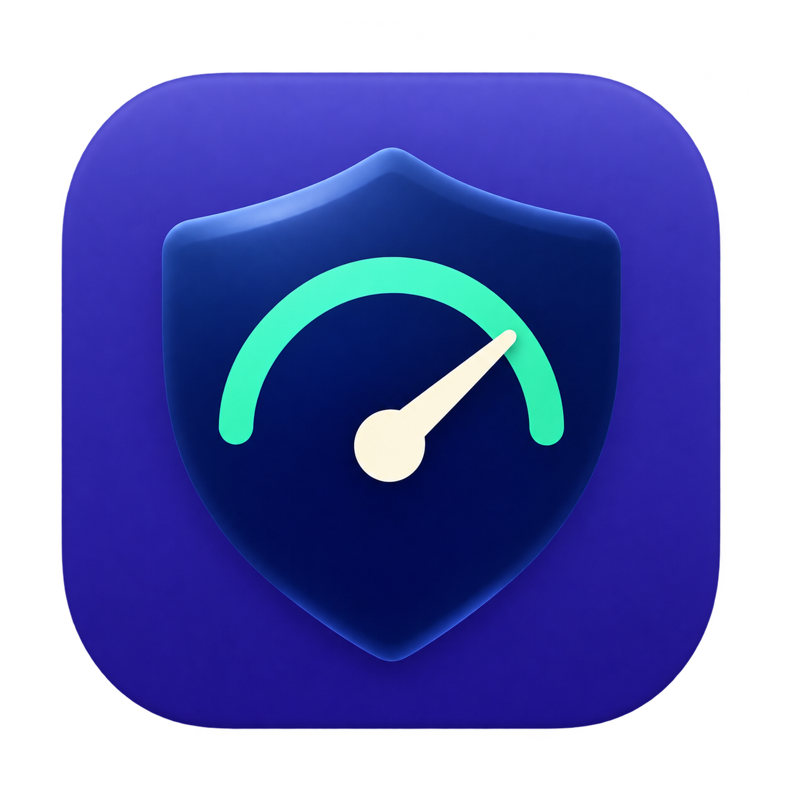

# mi-guard



`mihomo-guard` 是运行在 macOS 上的带宽选线守护进程。它可以为链式代理选择前置节点，也可以直接管理普通的手动选择组，在当前线路持续降速或断线时换线。手动 `bench` 可临时测试其他地区或新的机场订阅。

## 通过 Homebrew 安装

项目仓库同时作为 Homebrew tap。稳定版适用于运行 macOS 12 及以上版本的 Apple Silicon Mac。Homebrew 会校验发布包的 SHA-256 并安装预编译的 CLI 和通知助手。

```sh
brew tap lonelygo/mi-guard https://github.com/lonelygo/mi-guard.git
brew install lonelygo/mi-guard/mi-guard
mihomo-guard init    # 首次使用时创建配置，已有配置可直接沿用
```

Homebrew 把 `mihomo-guard` 链接到自己的 `bin`，同一版本的通知助手随包安装在 `$(brew --prefix mi-guard)/libexec/mi-guard.app`。默认的 `notifications.helper: auto` 会找到这个助手。已有 `make install` 安装的用户请参考下文的迁移说明。

用 `mihomo-guard -v` 或 `--version` 查看版本，用 `mihomo-guard -h` 或 `--help` 查看命令列表。运行 `mihomo-guard bench --help` 可查看测速参数。

喜欢短命令可以在自己的 `~/.zshrc` 中加入 `alias mig=mihomo-guard`，打开新终端后即可使用 `mig bench --help`。macOS 的 `/usr/bin/mig` 是 Mach Interface Generator，启用别名后仍可用这个完整路径调用它。

也可以从发布页下载 Apple Silicon 的 `.tar.gz` 和 `SHA256SUMS`，在下载目录运行 `shasum -a 256 -c SHA256SUMS`。解包后保留目录结构，运行包内的 `bin/mihomo-guard` 即可找到配套助手。[下载发布包](https://github.com/lonelygo/mi-guard/releases/latest)

## 配置 guard 和接入 Mihomo

| 文件 | 用法 |
| --- | --- |
| `~/.config/mihomo-guard/mihomo-guard.yaml` | 你实际编辑的 guard 配置。首次用 `mihomo-guard init` 创建，已有文件会保留。Homebrew 登录服务读取此路径，命令行可用 `-c /path/to/guard.yaml` 指定其他文件。 |
| [share/mi-guard/mihomo-guard-default.yaml](share/mi-guard/mihomo-guard-default.yaml) | 当前版本的完整默认值、单位、字段说明和额外组示例。内容与该版本 `init` 生成的文件逐字节相同。升级后可用它对照自己的配置。 |
| [share/mi-guard/mihomo-overlay.yaml](share/mi-guard/mihomo-overlay.yaml) | Mihomo 的接线示例。将其中的条目手动并入生效的 Mihomo 配置，再重新加载。 |

从 v0.1.1 起，源码仓库和解压后的发布包都在顶层的 `share/mi-guard/` 提供这两份 YAML。`make install` 默认将它们复制到 `~/.local/share/mi-guard/`。Homebrew 用户可以用以下命令查看。

```sh
less "$(brew --prefix mi-guard)/share/mi-guard/mihomo-guard-default.yaml"
cat  "$(brew --prefix mi-guard)/share/mi-guard/mihomo-overlay.yaml"
```

初次 `init` 后，将 `mihomo.config_path` 改为正在使用的 Mihomo 主配置路径，按实际组名填写 `groups`。使用 `bench --source` 时，还需将 `mihomo.stable_binary` 指向可执行的 Mihomo 内核。在线守护连接 `mihomo.controller` 指定的现有内核。文件路径支持 `~/`，相对路径以 guard 配置所在目录为基准。

以第一组为例，`name: primary-group-1` 指向 guard 可写的前置选择组。Mihomo 中名为 `dialer-proxy-1` 的链节点通过 `dialer-proxy: primary-group-1` 使用这个组。可在 guard 配置的 `selection` 下按完整组名指定随动关系。已有的 `groups[].direct` 继续生效，同一前置组优先使用 `follow_groups` 中的值。

```yaml
selection:
  sync_direct_on_warp_switch: true
  follow_groups:
    primary-group-1: direct-group-1
    primary-group-2: direct-group-2
```

在 **Mihomo 主配置**中，把接线示例的策略组和监听器分别加入现有的 `proxy-groups`、`listeners` 列表，并将 `proxy-providers-1` / `proxy-providers-2` 改为实际的 provider 名称。若主配置由订阅工具生成，请把这些条目维护在工具的持久覆写配置里。默认测速监听为 `127.0.0.1:17987`，测速组 `mi-guard-bench` 专供该监听器使用。

示例中的 `127.0.0.1:7898` 绑定链节点 `dialer-proxy-1`，用于检查这条链的出口地区。启用地区校验时，在对应 guard 组中填写 `geo_proxy` 和 `expected_geo`，并让 Mihomo 加载这个监听。关闭地区校验时，将两个字段同时留空。

从 v0.1.1 升级时，可以直接沿用已初始化的配置。手写精简配置如果曾省略路径或组名，请把实际值补入文件。

```sh
mihomo-guard status
mihomo-guard check
```

`check` 核对生效的监听和链路，按前置组显示当前节点、可用候选数、HTTP 延迟和最近带宽。可用数和延迟来自本次轻量 HTTP 探测，组间重叠节点只探测一次。带宽来自同一节点、供应商和路径的下载样本，附测量时间距今多久。运行 `check` 无需重新下载。

选用时长从 guard 确认换线或首次观察到该节点时算起，同组也会显示有记录以来选用最久的节点。外部手动换线会在下次观察时被发现。选线记录写在 `history.file` 同目录的 `<文件名>.selections.json`，可跨重启和账期使用。`status` 显示当前选择和账期用量，`status --probe` 还会探测实际链路和已配置的出口地区。

地区监听报 `connection refused` 时，先看 **Mihomo 内核启动或重载时的日志**。YAML 中存在 `listeners` 条目，只说明配置声明了这个端口。如果日志显示 `bind: address already in use`，说明当时端口已被占用，Mihomo 创建监听失败。解决占用后重新加载配置，再运行 `mihomo-guard check`。如果改用空闲端口，同时更新 Mihomo 的 `listeners[].port` 和对应 guard 组的 `geo_proxy`。

`GET /connections` 超时表示 guard 在本轮时限内未能通过控制器的连接表确认测速路径，相关时限由 `speedtest.timeout` 设置。`bench` 表格中的 `204 probe: HTTP 504` 表示节点健康检查超时，该节点本轮跳过下载。

### 增加链或只管理一个手动选择组

在 guard 的现有 `groups:` 列表追加条目，名称使用 Mihomo 中的完整名称。下面的第三个条目管理链式前置，最后一个条目只切换指定的 `type: select` 组。候选节点需要同时属于该组和专用测速组。

```yaml
  - name: primary-group-3
    mode: chain
    chain: dialer-proxy-3
  - name: optional-selector-group
    mode: selector
```

`groups` 按整个列表替换默认值。希望继续管理两个默认示例时保留原有两项。v0.1.0 配置省略 `mode` 时仍按 `chain` 处理。若今后只想管理 `direct-group-1`，可将整个第一项换成 `name: direct-group-1` 和 `mode: selector`。新增的普通组可以先用 `mihomo-guard bench -g optional-selector-group` 只看测速结果，再用同一命令加 `--apply` 应用选择。

## 手动测速

```sh
# 只测第二组候选，打印实际下载 Mbps、HTTP 探测延迟、失败次数及计费字节
mihomo-guard bench -g primary-group-2

# 临时测试任意已加载策略组；或按生效节点名、名字正则选择
mihomo-guard bench -g '日本节点'
mihomo-guard bench --node '控制器中显示的完整节点名'
mihomo-guard bench --filter '日本|Japan|JP'
# 两流，每流最多 4 MiB，每节点最多 8 MiB
mihomo-guard bench --filter 'JP' --streams 2 --bytes-per-stream 4194304
# 限定每节点合计 4 MiB，四条流各分到 1 MiB
mihomo-guard bench --filter 'JP' --streams 4 --bytes 4194304

# 临时读取一个未加载到在线内核的 provider 文件或订阅 URL
mihomo-guard bench --source path_to_your_provider.yaml -f 'JP|SG'
mihomo-guard bench --source 'https://example.org/subscription' --filter 'US'

# 用链名测试并切换前置组，终端会给出前置和随动组各自的结果
mihomo-guard bench -g dialer-proxy-1 --apply

# 临时测试普通策略组；唯一匹配即可省略 emoji 或只输入部分名称
mihomo-guard bench -g '日本' --apply
```

无参数的 `bench` 测 `groups` 中的所有纳管组。`-g` 优先匹配完整名称，其次匹配唯一的名称子串，英文字母忽略大小写。多个组或链命中时，命令会列出候选并在下载前退出。`--node` 仍按完整节点名匹配，`--filter` 仍使用正则表达式。

指定链名会测速该链的前置组。对普通组使用 `--apply` 无需先把它加入 daemon 的 `groups`。手动选择组只切换到它可以直接选择的合格成员。自动组也会出测速结果，并提示跳过切换。前置实际换线后，guard 才尝试让已配置的随动组选中同一节点。每次切换、保持或跳过都会打印组名和结果。选优沿用下节的 `near_best_pct` 策略。

终端会立即显示当前节点、完成数、用时和预计剩余时间，每测完一个节点即显示其结果。进度写入标准错误，按下载速度排序的最终表格写入标准输出，方便重定向。表中 `Mbps` 为每秒百万比特，`MiB/s` 为每秒 1,048,576 字节，`HTTP ms` 为 204 探测延迟。`FAIL/TRY` 统计本轮应用层探测和下载的失败次数与尝试次数。

手动 `bench` 默认逐个节点测速，每个节点并发 **4 流 × 每流 4 MiB**，每节点最多 16 MiB，8 个节点一轮最多 128 MiB 下载响应体。每个节点开始时预留整份额度，余额不足即停止。正常结束或取消后按实际读取的响应体字节结算。四流的总吞吐量用所有流的实际字节总和除以同一段经过时间计算。

可用 `speedtest.bench_streams`（1～8）和 `speedtest.bench_bytes_per_stream` 修改手动默认值。`--bytes` 保留每节点总上限的含义，与 `--bytes-per-stream` 互斥。升级后，旧配置中的 `streams_per_node: 1` 自动使用新的手动默认值。旧值 2～8 在未填写 `bench_streams` 时沿用为手动并发数。原有 `sweep_bytes` 继续控制 daemon 完整扫描。希望手测也用单流时可写 `bench_streams: 1`，或临时加 `--streams 1`。

在线模式只测专用测速组可达的物理节点。每条下载连接在发出请求前都会核对实际 selector 和节点，测完会恢复测速组原选择。与其他测速工具比较时，请对齐节点、下载地址、并发数、每节点总额度和超时。guard 默认从 Cloudflare 下载。clash-speedtest v1.8.8 默认从 Google 下载，每节点 4 流、目标 50 MiB。它在界面上显示的 `MB/s` 按 1024 进制换算，可对照这里的 `MiB/s` 列。[clash-speedtest 默认参数](https://github.com/faceair/clash-speedtest/blob/v1.8.8/main.go#L32-L38) · [上游速度单位](https://github.com/faceair/clash-speedtest/blob/v1.8.8/speedtester/speedtester.go#L420-L431)

`--source` 接受带顶层 `proxies` 列表的 Mihomo YAML，可重复使用。它用配置中 `stable_binary` 指定的 Mihomo 启动临时核心。临时核心关闭 TUN，通过临时回环监听和独立 selector 串行测速，退出后回收进程和临时文件。独立模式会核对启动后的版本，默认要求正式版。需要试验 alpha 时可显式设置 `mihomo.allow_prerelease: true`。两个模式共享同一个 guard 配置的账期预算。若系统级 TUN 接管其他进程流量，使用独立实例测试前应确认该核心进程到机场服务器的连接直出，或采用在线测速组。

## 自动选线

| 设置 | 默认值 | 行为 |
| --- | --- | --- |
| 心跳 | 每 30 秒，3 秒超时 | 连续两次失败后轻量验证历史备选，恢复优先 |
| 全组下载 | 每 12 小时，每节点 4 MiB | 一次扫描两个前置组，直出组共用结果 |
| 在用节点快筛 | 每 2 小时，每节点 1 MiB | 可设 `active_interval: 0s` 关闭 |
| 降速准备 | `severe_drop_pct: 20` | 当前带宽 ≤ 正常样本中位数 × 0.8 后进入复测 |
| 复测 | 默认间隔 1 分钟，累计 2 次，单次最多 8 MiB | 确认降速且有更好备选才切 |
| 选优容差 | `near_best_pct: 20` | 本轮达到最快节点的 80% 即进入同一优先档 |
| 历史和预算 | 每节点 50 次，6 GiB/账期 | JSON 保存，每次实际读取的下载响应体字节计入账期 |

例如当前节点的正常水平为 8 MB/s，降到 6.4 MB/s 就开始准备。若当初选中的节点为当时最快速度的 80%，再下降 20% 相当于那次最快速度的 64%。这个乘积只用来理解两个阈值，实际判断分别使用当前节点的历史基准和本轮各候选的新测量。

带宽探测分别统计一次 204 和一次有界下载，响应体中断会记录失败。冷启动缺少历史时，可以在组上设置绝对下限 `min_mbps`。该下限使用本次实测的 Mbps，daemon 取单流速度，手动 `--apply` 取所选流数的合计速度。连续下载失败也会触发确认。连续两次链路硬故障可以越过性能冷静期。

同档候选比较应用层探测失败比例和历史低分位带宽，平手时优先留用原节点。手动 `bench --apply` 使用本轮实测，并只参考相同节点、provider、路径、流数、请求额度、探测地址和超时的手测历史。第一次四流测试可直接选线。daemon 的降速基准来自它自己的单流扫描和复测。两种模式共用每个 provider 和节点的历史窗口，默认保留最近 50 条。窗口内缺少测速参数的旧记录仍可在 `check` 中看到，选线从有完整参数的样本开始积累。

daemon 的完整扫描、快筛和复测固定单流。以完整扫描为例，16 个节点每个读满 4 MiB，每天两轮，30 天共 3.75 GiB 下载响应体。手动命令与 daemon 共用同一账期预算，协议开销和机场计费倍率另计。guard 互斥访问测速组、原子更新 JSON，进程异常退出时预留字节暂按已用处理。

切换时先调整 `primary-group-1` / `primary-group-2`，再验证相应的 `dialer-proxy-1` / `dialer-proxy-2` 链。第一组可按预期 Google 地区顺位尝试。验证成功后，在候选仍属于直出组的前提下，尽力同步 `direct-group-1` / `direct-group-2`。直出跟随失败只影响直出组。守护进程会接纳手动选线，并在换线前重新读取当前选择。

## 登录时运行与系统通知

初始化 guard 配置后，在当前 macOS 桌面会话运行 `mihomo-guard notify-setup`，即可单独申请通知权限。`check` 用于验证 Mihomo 接线，通知授权可以在接线完成前进行。首次请求时，macOS 会显示 mi-guard 的通知提示。如果系统已记录拒绝，可在「系统设置 → 通知 → mi-guard」打开「允许通知」。

```sh
mihomo-guard notify-setup
```

本版也可以通过 Finder 打开 `mi-guard.app` 进入通知设置。已安装 v0.1.2 的用户请使用上面的命令。后台守护使用已授予的权限发送通知。

接线检查通过后，启用登录服务。

```sh
brew services start lonelygo/mi-guard/mi-guard
brew services info lonelygo/mi-guard/mi-guard
```

`brew services start` 启动守护进程并注册当前用户的登录项。日志写入 `~/Library/Logs/mihomo-guard.log`。全组扫描结束后发送一条摘要，切换通知会报告主组和直出组的最终结果。可分别关闭 `notifications.summary` 和 `notifications.switch`。横幅显示遵循 macOS 的通知设置与专注模式。

```sh
brew update
brew upgrade lonelygo/mi-guard/mi-guard                # 升级到最新稳定版
brew services restart lonelygo/mi-guard/mi-guard       # 升级或修改配置后重启
brew services stop lonelygo/mi-guard/mi-guard          # 停止并取消登录自启
```

### 从 `make install` 迁移

Homebrew 版沿用原来的配置和测速历史。启用 Brew 服务前，若旧 LaunchAgent 已加载，先执行 `launchctl bootout "gui/$(id -u)/com.lonelygo.mi-guard"`。若 `~/Library/LaunchAgents/com.lonelygo.mi-guard.plist` 存在，把它移出 LaunchAgents 目录，避免下次登录启动两份守护进程。`command -v mihomo-guard` 应指向 Homebrew 的 `bin`。

旧配置若指定 `helper: ~/Applications/mi-guard.app`，且旧 App 仍在，通知会继续使用它。将该行改为 `helper: auto` 后，通知会使用当前安装包中的图标和助手。自定义助手仍可使用自己的路径。

### 从工作副本构建

源码构建需要 Go 和 Xcode Command Line Tools。要通过 Homebrew 跟踪 `main`，可使用 `brew install --HEAD lonelygo/mi-guard/mi-guard`。在源码目录运行 `make macos` 可得到 `build/mihomo-guard` 和 `build/mi-guard.app`，可直接用 `./build/mihomo-guard` 运行上述 CLI 命令。已有手动部署也可继续使用用户目录安装。

```sh
make install
~/.local/bin/mihomo-guard notify-setup
launchctl bootstrap "gui/$(id -u)" "$HOME/Library/LaunchAgents/com.lonelygo.mi-guard.plist"
```

## 验证与设计

`make test` 运行 Go 竞态测试和静态检查。`make smoke` 通过本机稳定内核、临时控制器和回环测试服务器检查 CLI 的手动测速和切换。可用 `make smoke STABLE_CORE=/path/to/mihomo` 选择测试用核心。[现行设计](https://github.com/lonelygo/mi-guard/blob/main/mihomo_guard_mac.md) · [实施计划](https://github.com/lonelygo/mi-guard/blob/main/.omx/plans/implementation.md)

维护者在 `main` 上推送带发布说明的 `vX.Y.Z` 标签后，GitHub Actions 会测试并打包、发布归档和校验文件、更新 tap，再从公开的 tap 安装并运行 `brew test`。[发布工作流](https://github.com/lonelygo/mi-guard/blob/main/.github/workflows/release.yml)

## 致谢与许可证

感谢 **faceair/clash-speedtest** 提供节点下载测速的实现，以及 **MetaCubeX/mihomo** 提供协议内核、策略组和外部控制器。下载器裁剪自 clash-speedtest 提交 `1e1fb9e2bbb29282cce5613a6c6b946b85169fdc`。修改包含本地监听器拨号、按节点限制读取量、取消处理、部分读取错误和实际耗时计量。mi-guard 采用 GNU GPL v3 发布。[上游测速源码](https://github.com/faceair/clash-speedtest/blob/1e1fb9e2bbb29282cce5613a6c6b946b85169fdc/speedtester/speedtester.go) · [Mihomo](https://github.com/MetaCubeX/mihomo/tree/Meta) · [许可证](LICENSE)
